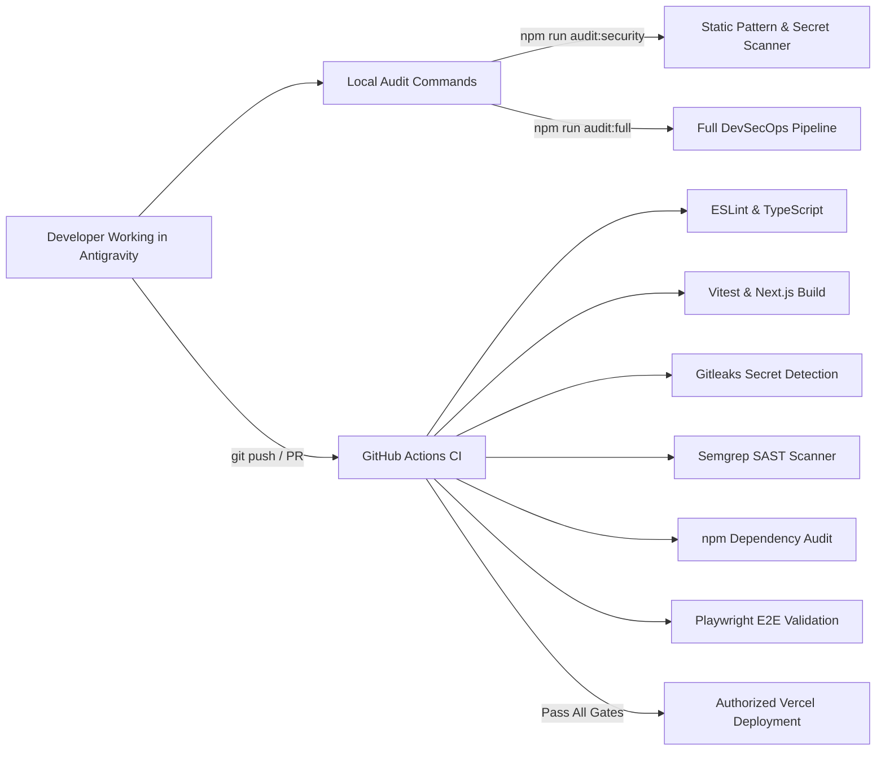

# DevSecOps Security Workflow Guide

**Application:** Kids Time Khilgaon  
**Maintainer:** Application Security & DevSecOps  

---

## 1. Automated Security Scanning Architecture

This project incorporates a continuous automated security auditing pipeline that functions both locally during development and centrally in GitHub Actions CI/CD.

---

## 2. DevSecOps Tooling Reference

### A. Local Static Security Scanner (`scripts/audit-security.mjs`)
- **Zero-Dependency Native Execution:** Runs directly via Node.js with zero external dependencies.
- **Checks Performed:**
  - Hardcoded Supabase service role keys, database connection URIs, AWS/GitHub/OpenAI tokens.
  - Permissive Supabase RLS policies (`FOR ALL TO authenticated USING (true)`).
  - Privilege escalation patterns in PostgreSQL triggers (`handle_new_user`).
  - Public exposure of attendee PII in event RSVPs.
  - Unauthenticated API mutation endpoints (`/api/seed`).
  - Missing HTTP security headers in `next.config.ts`.
  - Sensitive applicant PII in public Supabase storage buckets.
- **CLI Integrations:** Automatically detects and triggers local `semgrep` and `gitleaks` binaries if installed on the host machine.
- **Output:** Outputs terminal report and saves structured JSON results to `security/scan-results.json`.

---

### B. Semgrep SAST Scanner (GitHub Actions CI)
- **Role:** Deep Semantic Static Application Security Testing.
- **Rule Packs Configured:**
  - `p/security-audit`: General security weaknesses and code quality flags.
  - `p/secrets`: High-entropy token detection.
  - `p/owasp-top-ten`: Identification of injection, SSRF, XSS, and broken access control.
  - `p/react` & `p/typescript`: Dangerous coding patterns in React and TypeScript.
- **Workflow File:** `.github/workflows/ci.yml` (Job: `security-scan`).

---

### C. Gitleaks Secret Scanner (GitHub Actions CI)
- **Role:** Commited & staged secret detection.
- **Detects:** API keys, Supabase service role tokens, private keys, database passwords.
- **Rule:** Never prints raw secrets in logs; redacts findings automatically.

---

### D. Dependabot Vulnerability Scanning
- **Role:** Automated continuous monitoring of third-party package dependencies.
- **Schedule:** Weekly scans for `npm` and `github-actions`.
- **Workflow File:** `.github/dependabot.yml`.

---

### E. OWASP ZAP Baseline DAST Scan
- **Role:** Dynamic Application Security Testing against live HTTP responses.
- **Workflow File:** `.github/workflows/owasp-zap.yml`.
- **Trigger:** Scheduled weekly on Sundays or manually triggered via `workflow_dispatch` against staging/preview URLs.

---

## 3. Developer Security Commands

| Command | Purpose | When to Use |
|---|---|---|
| `npm run audit:security` | Runs fast local pattern, RLS policy, and secret scanner. | Daily during coding and before committing. |
| `npm run audit:dependencies` | Evaluates third-party package trees for known CVEs. | Before adding or upgrading packages. |
| `npm run audit:full` | Executes full audit (Quality + Security + Dependencies + Tests). | Before creating pull requests or releases. |
