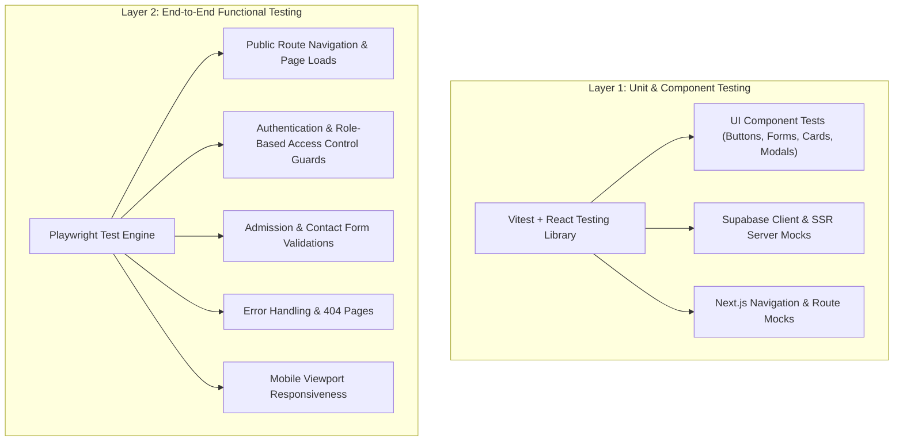

# Automated Testing Guide

**Application:** Kids Time Khilgaon  
**Test Frameworks:** Vitest 4.x (Unit & Component) & Playwright 1.x (E2E)  

---

## 1. Testing Architecture Overview

The testing strategy is structured into two complementary layers:



---

## 2. Test Execution Commands

| Command | Purpose | Execution Time |
|---|---|---|
| `npm run test` | Executes the complete Vitest test suite (2,392 tests). | ~25s |
| `npm run test:watch` | Starts Vitest in interactive watch mode for TDD development. | Continuous |
| `npm run test:e2e` | Runs Playwright functional E2E tests against local dev server. | ~35s |
| `npx playwright test --ui` | Opens Playwright UI mode with interactive step-by-step inspector. | On-demand |
| `npm run audit:test` | Runs both Unit tests and Playwright E2E tests in sequence. | ~1m |

---

## 3. Writing Unit & Component Tests (Vitest)

- **Location:** `tests/components/` and `tests/backend/`
- **Setup File:** `tests/setup.ts` (automatically configures `@testing-library/jest-dom`, mocks `next/navigation`, and mocks `window.matchMedia` and `ResizeObserver`).
- **Example Component Test:**
  ```tsx
  import { render, screen } from '@testing-library/react'
  import { Button } from '@/components/ui/button'
  import { describe, it, expect } from 'vitest'

  describe('Button Component', () => {
    it('renders with children and default classes', () => {
      render(<Button>Click Me</Button>)
      expect(screen.getByRole('button', { name: /click me/i })).toBeInTheDocument()
    })
  })
  ```

---

## 4. Writing Functional E2E Tests (Playwright)

- **Location:** `tests/e2e/functional-audit.spec.ts`
- **Configuration:** `playwright.config.ts` (configured with `baseURL: 'http://localhost:3000'` and automated `webServer` dev server startup).
- **Core Principles:**
  - **Test Real Features:** Only test functionality that exists in the codebase.
  - **Safe Test Data:** Never modify production records during automated test runs.
  - **Resilient Locators:** Prefer semantic locators (`getByRole`, `locator('header')`) over brittle CSS classes that might change during redesigns.
  - **Avoid Strict Mode Ambiguity:** When multiple elements share a generic tag, scope to specific parent containers (e.g. `page.locator('header nav').first()`).

---

## 5. Continuous Integration (CI) Behavior

In GitHub Actions (`.github/workflows/ci.yml`):
- Unit tests are executed first in parallel with code quality checks.
- Playwright E2E tests run following successful production build verification, downloading headless Chromium and testing real server page responses.
