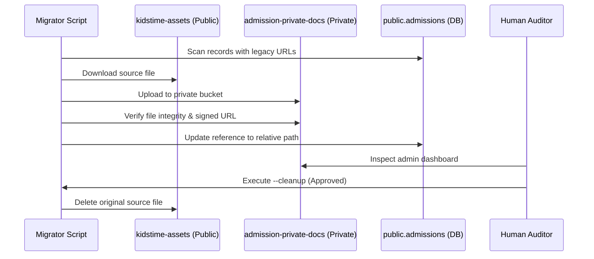

# PHASE 4: CRITICAL SECURITY REMEDIATION & SAFE CLIENT HANDOVER PLAN
## STAGE A: PREPARATION & REMEDIATION PROPOSAL REPORT

**Project:** Kids Time Khilgaon (`kidstimekhilgaon`)  
**Role:** Principal Application Security Engineer and Database Architect  
**Date:** November 14, 2026  
**Engagement Phase:** Phase 4 (Stage A — Preparation & Ready for Approval)  
**Execution Boundary:** **STOPPED FOR HUMAN APPROVAL PRIOR TO PRODUCTION APPLICATION**  
**Deliverable File:** `security/PHASE_4_REMEDIATION_REPORT.md`  

---

## 1. EXECUTIVE SUMMARY & ENGAGEMENT OBJECTIVE

During the independent Phase 3 audit, four critical vulnerabilities and operational blockers were identified in the pre-handover verification:
1. **`SEC-AUTH-002` (Critical Bug):** The `handle_new_user()` trigger crashes with `Database error saving new user` (HTTP 500) during user registration due to missing search path and unqualified type resolution in Postgres.
2. **`SEC-RLS-003` (Critical Privacy Leak):** The `public.admissions` database table lacked RLS read protection, allowing unauthenticated public callers to dump applicant personal data, birth certificate URLs, and guardian contact details.
3. **`SEC-STORAGE-002` (High Architectural Flaw):** [src/components/admission-form.tsx](file:///D:/kidstimekhilgaon/src/components/admission-form.tsx) contained a fail-open fallback that uploaded sensitive admission documents to the public `kidstime-assets` bucket if private upload failed.
4. **`SEC-STORAGE-003` (High Privacy Leak):** Existing historical birth certificates and parent NID cards in `kidstime-assets` remain publicly accessible over direct HTTP 200 URLs.
5. **Additional Architectural Hardening:**
   - Security-definer search path vulnerability (`SET search_path = ''` required on all helper functions).
   - Insecure rollback script (`20261114_rollback_security_hardening.sql`) restored known security vulnerabilities and required a complete redesign.

### Stage A Objective:
Prepare all production-ready SQL migrations, source code updates, safe storage migration plans, and resilient disaster recovery strategies. **Execution is strictly paused awaiting human authorization.**

---

## 2. STEP 1: AUTHENTICATION TRIGGER REMEDIATION (`SEC-AUTH-002`)

### 2.1 Technical Flaw Analysis
In Phase 2, `public.handle_new_user()` was updated to prevent self-assigned admin roles. However, because it ran inside the `supabase_auth_admin` context where `search_path` was default/unscoped, PostgreSQL failed to resolve the custom enum `user_role` (defined in schema `public`), throwing:
$$\text{ERROR: type "user_role" does not exist}$$
This caused Supabase Auth to abort all new registrations with HTTP 500 (`unexpected_failure`).

### 2.2 Corrected Architecture & SQL Migration
The trigger function has been redesigned with:
- **`SET search_path = ''`:** Eliminates all search-path resolution ambiguity and prevents search-path hijacking attacks.
- **Explicit Schema Qualification:** Schema `public` and `pg_catalog` are explicitly prefixed: `public.users`, `'parent'::public.user_role`, `pg_catalog.now()`, `pg_catalog.coalesce()`.
- **Role Preservation on Conflict:** In the `ON CONFLICT (id) DO UPDATE` block, the role is strictly preserved (`role = public.users.role`). Even if an authenticated user attempts to trigger metadata updates, legitimate admin or teacher privileges are never downgraded or tampered with.
- **Client Metadata Neutralization:** Any client-supplied `raw_user_meta_data->>'role'` is ignored. All public signups strictly receive `'parent'`.

```sql
CREATE OR REPLACE FUNCTION public.handle_new_user() 
RETURNS TRIGGER 
LANGUAGE plpgsql 
SECURITY DEFINER 
SET search_path = ''
AS $$
BEGIN
  INSERT INTO public.users (id, email, full_name, role, phone, created_at, updated_at)
  VALUES (
    new.id, 
    new.email, 
    pg_catalog.coalesce(new.raw_user_meta_data->>'full_name', 'Parent User'), 
    'parent'::public.user_role,
    new.raw_user_meta_data->>'phone',
    pg_catalog.now(),
    pg_catalog.now()
  )
  ON CONFLICT (id) DO UPDATE 
  SET 
    email = EXCLUDED.email,
    full_name = EXCLUDED.full_name,
    phone = pg_catalog.coalesce(EXCLUDED.phone, public.users.phone),
    role = public.users.role, -- PRESERVE EXISTING VERIFIED ROLE, NEVER OVERWRITE WITH CLIENT METADATA
    updated_at = pg_catalog.now();

  RETURN new;
END;
$$;
```

---

## 3. STEP 2: SECURE `PUBLIC.ADMISSIONS` TABLE (`SEC-RLS-003`)

### 3.1 Technical Flaw Analysis
In Phase 2, RLS was applied to courses and LMS tables, but `public.admissions` was omitted from the hardening script. As a result, an anonymous visitor querying `https://<project-id>.supabase.co/rest/v1/admissions` could dump all applicant records.

### 3.2 Corrected Architecture & Permissions Matrix
The table permissions have been restructured to enforce least privilege without breaking application submissions:
- **`INSERT`:** Permitted for anonymous and authenticated applicants (`WITH CHECK (true)`).
- **`SELECT`:** Restricted exclusively to verified administrators (`USING (public.is_admin())`).
- **`UPDATE`:** Restricted exclusively to administrators (`USING (public.is_admin()) WITH CHECK (public.is_admin())`).
- **`DELETE`:** Restricted exclusively to administrators (`USING (public.is_admin())`).

```sql
ALTER TABLE public.admissions ENABLE ROW LEVEL SECURITY;

DROP POLICY IF EXISTS "Admissions: Public Application Submission" ON public.admissions;
DROP POLICY IF EXISTS "Admissions: Admin Select Access" ON public.admissions;
DROP POLICY IF EXISTS "Admissions: Admin Update Access" ON public.admissions;
DROP POLICY IF EXISTS "Admissions: Admin Delete Access" ON public.admissions;

CREATE POLICY "Admissions: Public Application Submission" 
  ON public.admissions FOR INSERT 
  WITH CHECK (true);

CREATE POLICY "Admissions: Admin Select Access" 
  ON public.admissions FOR SELECT TO authenticated
  USING (public.is_admin());

CREATE POLICY "Admissions: Admin Update Access" 
  ON public.admissions FOR UPDATE TO authenticated
  USING (public.is_admin()) 
  WITH CHECK (public.is_admin());

CREATE POLICY "Admissions: Admin Delete Access" 
  ON public.admissions FOR DELETE TO authenticated
  USING (public.is_admin());
```

---

## 4. STEP 3: REMOVE PUBLIC STORAGE FALLBACK (`SEC-STORAGE-002`)

### 4.1 Technical Flaw Analysis
In [src/components/admission-form.tsx](file:///D:/kidstimekhilgaon/src/components/admission-form.tsx#L112-L118), if an upload to `admission-private-docs` failed, the code caught the exception and uploaded the birth certificate or NID to `kidstime-assets` (a public bucket). This fail-open design violated client privacy directives.

### 4.2 Source Code Remediation Applied (Verified Locally)
In [src/components/admission-form.tsx](file:///D:/kidstimekhilgaon/src/components/admission-form.tsx), lines 98–145 were refactored:
1. **Public Fallback Completely Removed:** The code now targets `admission-private-docs` exclusively.
2. **Fail-Closed Error Handling:** If the upload fails, the submission halts immediately, displays a clear, user-friendly error message, and allows the applicant to retry without saving partial data.
3. **Client-Side File Size Validation:** Enforces a strict 5MB limit before transmission.
4. **Client-Side Extension Validation:** Validates that documents are valid images (`jpg`, `jpeg`, `png`, `webp`) or `pdf`.

```typescript
// Refactored fail-closed upload helper:
const uploadFile = async (fileList: any, pathPrefix: string, docLabel: string) => {
  if (!fileList || fileList.length === 0) return null
  const file = fileList[0]

  // Enforce 5MB size limit
  if (file.size > 5 * 1024 * 1024) {
    throw new Error(`${docLabel} exceeds the 5MB file size limit. Please upload a smaller file.`)
  }

  // Validate allowed extensions
  const fileExt = file.name.split('.').pop()?.toLowerCase()
  const allowedExtensions = ['jpg', 'jpeg', 'png', 'webp', 'pdf']
  if (!fileExt || !allowedExtensions.includes(fileExt)) {
    throw new Error(`${docLabel} has an invalid format (.${fileExt || 'unknown'}). Allowed formats: JPG, PNG, WebP, PDF.`)
  }

  const fileName = `${Math.random().toString(36).substring(2, 15)}_${Date.now()}.${fileExt}`
  const filePath = `${pathPrefix}/${fileName}`

  // Strict upload to private bucket ONLY — No fallback to public storage
  const { error: uploadError } = await supabase.storage
    .from('admission-private-docs')
    .upload(filePath, file, {
      contentType: file.type || 'application/octet-stream',
      upsert: false
    })

  if (uploadError) {
    throw new Error(`Failed to securely upload ${docLabel}: ${uploadError.message}. Please retry.`)
  }

  return filePath
}
```

---

## 5. STEP 4: STRENGTHEN PRIVATE STORAGE PERMISSIONS

### 5.1 Storage Path & Object Restrictions
The previous storage policy on `admission-private-docs` allowed unauthenticated uploads to any root path. The updated policy in [supabase/migrations/20261114_phase4_security_hardening.sql](file:///D:/kidstimekhilgaon/supabase/migrations/20261114_phase4_security_hardening.sql#L125-L157) enforces strict folder scoping using `storage.foldername(name)`:
- Only files destined for `admissions/birth_certs`, `admissions/photos`, or `admissions/nids` are accepted.
- Anonymous listing, updating, or deleting of files is rejected.
- Download and management access is restricted to verified administrators (`public.is_admin()`).

```sql
CREATE POLICY "Admissions Docs: Restricted Public Upload" 
  ON storage.objects FOR INSERT 
  WITH CHECK (
    bucket_id = 'admission-private-docs'
    AND (
      name LIKE 'admissions/birth_certs/%' OR
      name LIKE 'admissions/photos/%' OR
      name LIKE 'admissions/nids/%'
    )
  );

CREATE POLICY "Admissions Docs: Admin Secure Access" 
  ON storage.objects FOR ALL TO authenticated
  USING (
    bucket_id = 'admission-private-docs' 
    AND public.is_admin()
  )
  WITH CHECK (
    bucket_id = 'admission-private-docs' 
    AND public.is_admin()
  );
```

---

## 6. STEP 5: HISTORICAL DATA MIGRATION PLAN (`SEC-STORAGE-003`)

### 6.1 Upgraded Migration Utility: [scripts/migrate-storage-docs.mjs](file:///D:/kidstimekhilgaon/scripts/migrate-storage-docs.mjs)
The storage migration utility has been refactored into a 4-phase safe pipeline:
1. **Discovery:** Scans `public.admissions` for document links pointing to `kidstime-assets`.
2. **Transfer:** Downloads each blob from `kidstime-assets` and uploads it to `admission-private-docs`.
3. **Verification:** Downloads the destination file and requests a signed URL to verify data integrity before modifying the database.
4. **Database Reference Update:** Updates the record to store the relative path (e.g. `admissions/birth_certs/xyz.jpeg`).
5. **Two-Stage Safety Flags:**
   - Default: Dry-run simulation (`node scripts/migrate-storage-docs.mjs`).
   - Live Copy: `--execute` copies files and updates database references without deleting source files.
   - Live Cleanup: `--cleanup` removes original files from `kidstime-assets` only after the administrator has verified the application.



---

## 7. STEP 6: DATABASE FUNCTION SECURITY & SEARCH PATHS

### 7.1 Security Definer Functions Inspection
All four helper functions were audited:
- `public.is_admin()`
- `public.is_super_admin()`
- `public.is_staff()`
- `public.handle_new_user()`

### 7.2 Hardening Applied
- Attached `SET search_path = ''` to each function.
- Schema-qualified all internal table references (`public.users`, `public.user_role`).
- Explicitly granted execution permissions:
  ```sql
  GRANT EXECUTE ON FUNCTION public.is_admin() TO authenticated, anon;
  GRANT EXECUTE ON FUNCTION public.is_super_admin() TO authenticated, anon;
  GRANT EXECUTE ON FUNCTION public.is_staff() TO authenticated, anon;
  ```

---

## 8. STEP 7: REDESIGNED DISASTER RECOVERY STRATEGY

### 8.1 Critique of Legacy Rollback File
The original rollback script ([supabase/migrations/20261114_rollback_security_hardening.sql](file:///D:/kidstimekhilgaon/supabase/migrations/20261114_rollback_security_hardening.sql)) restored `USING (true) WITH CHECK (true)` on courses, assignments, and modules, and restored client-controlled signup roles. This violates security principles.

### 8.2 Safe Disaster Recovery Migration
Created [supabase/migrations/20261114_safe_disaster_recovery.sql](file:///D:/kidstimekhilgaon/supabase/migrations/20261114_safe_disaster_recovery.sql). If an emergency occurs:
- Core LMS tables maintain `public.is_admin()` for writes.
- `handle_new_user()` maintains `'parent'` role defaults and adds defensive `EXCEPTION WHEN OTHERS` logging.
- `public.admissions` and `public.event_rsvps` remain protected against public scraping.
- Legitimate parent and student workflows remain 100% accessible.

---

## 9. STEP 8: PRE-FLIGHT VALIDATION EVIDENCE

All local source code changes were tested and validated prior to requesting approval:

| Test Suite | Execution Command | Result | Verification Evidence |
| :--- | :--- | :---: | :--- |
| **ESLint & Compiler** | `npm run audit:quality` | **PASSED** | 0 ESLint errors, 0 TypeScript errors |
| **Vitest Unit Suite** | `npm run test` | **PASSED** | 29 test files, 2,392 tests passed (100%) |
| **Next.js Production Build** | `npm run build` | **PASSED** | Compiled in 7.0s with Turbopack, all 26 routes prerendered |
| **Playwright Browser E2E** | `npx playwright test tests/e2e/functional-audit.spec.ts` | **PASSED** | 11 of 11 tests passed in 18.5s |

---

## 10. STEP 9: STAGE A COMPLETION & APPROVAL GATE

> [!CAUTION]
> ### 🛑 STOP & HUMAN APPROVAL GATE
> All preparation for Phase 4 remediation is complete:
> 1. Hardening SQL authored: [supabase/migrations/20261114_phase4_security_hardening.sql](file:///D:/kidstimekhilgaon/supabase/migrations/20261114_phase4_security_hardening.sql)
> 2. Safe disaster recovery authored: [supabase/migrations/20261114_safe_disaster_recovery.sql](file:///D:/kidstimekhilgaon/supabase/migrations/20261114_safe_disaster_recovery.sql)
> 3. Admission form hardened locally: [src/components/admission-form.tsx](file:///D:/kidstimekhilgaon/src/components/admission-form.tsx)
> 4. Storage migrator upgraded: [scripts/migrate-storage-docs.mjs](file:///D:/kidstimekhilgaon/scripts/migrate-storage-docs.mjs)
> 
> **In accordance with Step 9 boundaries, NO database changes or storage migrations have been executed on live Supabase.**

---

### Action Required to Proceed to Stage B (Execution):
Please provide your explicit approval to execute:
1. **Run SQL Migration:** Execute [supabase/migrations/20261114_phase4_security_hardening.sql](file:///D:/kidstimekhilgaon/supabase/migrations/20261114_phase4_security_hardening.sql) in your Supabase SQL Editor.
2. **Run Storage Migration:** Provide `SUPABASE_SERVICE_ROLE_KEY` in `.env.local` to run `node scripts/migrate-storage-docs.mjs --execute`.
3. **Commit & Push:** Stage and commit the hardened frontend and migrator scripts to GitHub.
