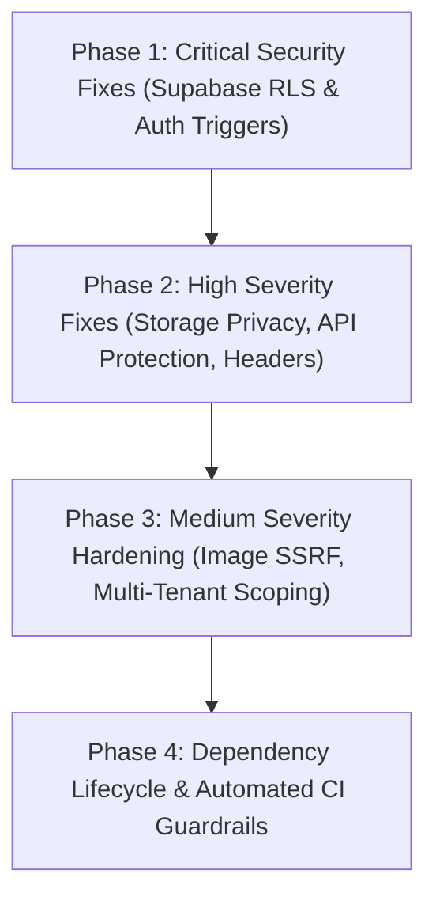

# DevSecOps Remediation & Hardening Plan

**Project:** Kids Time Khilgaon  
**Date:** November 14, 2026  
**Auditor:** Senior DevSecOps Engineering Team  

---

## 1. Overview & Prioritization Strategy

This remediation plan organizes all discovered vulnerabilities and security findings into four distinct execution phases based on business impact, ease of implementation, and approval requirements.

---

## 2. Phase Breakdown

### Phase 1: Critical Security Fixes (Requires User Approval Before DB Execution)

> [!CAUTION]
> These database policy and trigger updates modify production authorization rules. Verify with administrator credentials in the Supabase Dashboard before executing.

1. **Fix Insecure Auth Trigger (`SEC-AUTH-001`):**
   - **File:** Execute in Supabase SQL Editor.
   - **Action:** Replace `handle_new_user()` so that `role` defaults strictly to `'parent'`. Remove `new.raw_user_meta_data->>'role'` from untrusted client input.
   - **Verification:** Register a test account with custom metadata and verify `public.users.role` is `'parent'`.
2. **Restrict Administrative RLS Policies (`SEC-RLS-001`):**
   - **File:** Execute in Supabase SQL Editor (`fix_admin_rls.sql`).
   - **Action:** Replace `FOR ALL TO authenticated USING (true)` with `public.is_admin()` checks on:
     - `courses`
     - `assignments`
     - `modules`
     - `enrollments`
     - `trial_class_requests`
     - `teacher_profiles`
   - **Verification:** Login with a parent account and attempt to delete a test course; confirm HTTP 403 / RLS policy rejection.

---

### Phase 2: High Severity Remediation (Code & Configuration)

1. **Protect Database Seeding Route (`SEC-API-001`):**
   - **File:** `src/app/api/seed/route.ts`
   - **Action:** Add bearer token authentication using `process.env.INTERNAL_SEED_SECRET` or restrict to `process.env.NODE_ENV !== 'production'`.
   - **Verification:** Send an unauthenticated GET request to `/api/seed`; verify 401 Unauthorized response.
2. **Secure Sensitive Applicant Documents (`SEC-STORAGE-001`):**
   - **Files:** Supabase Storage & `src/components/admission-form.tsx`
   - **Action:**
     - Create a private bucket `admission-private-docs`.
     - In `admission-form.tsx`, upload birth certificates and NID cards to `admission-private-docs`.
     - Admin dashboard views should generate temporary signed URLs via `createSignedUrl` instead of permanent public URLs.
   - **Verification:** Confirm files cannot be accessed anonymously via direct browser URL.
3. **Prevent Attendee PII Scraping on Event RSVPs (`SEC-RLS-002`):**
   - **File:** Execute in Supabase SQL Editor.
   - **Action:** Remove public SELECT policy on `event_rsvps`. Allow SELECT only to administrators (`public.is_admin()`).
   - **Verification:** Query `event_rsvps` with anon key; confirm zero records returned.
4. **Implement HTTP Security Headers (`SEC-HDR-001`):**
   - **File:** `next.config.ts`
   - **Action:** Add `headers()` returning `X-Frame-Options: DENY`, `X-Content-Type-Options: nosniff`, `Referrer-Policy: strict-origin-when-cross-origin`, and `Permissions-Policy`.
   - **Verification:** Run `curl -I http://localhost:3000` and inspect returned headers.

---

### Phase 3: Medium Severity Hardening

1. **Restrict Image Optimization Remote Patterns (`SEC-IMG-001`):**
   - **File:** `next.config.ts`
   - **Action:** Replace wildcard `**` with explicit trusted domains:
     - `images.unsplash.com`
     - `<your-project-id>.supabase.co`
     - `ui-avatars.com`
   - **Verification:** Run `npm run build` and ensure Next.js image components render without domain errors.
2. **Sanitize Rich Text CMS Output (`SEC-XSS-001`):**
   - **Files:** `src/components/rich-text-editor.tsx`, `src/app/dashboard/content/page.tsx`
   - **Action:** Install and use `isomorphic-dompurify` to sanitize HTML output before rendering on public pages.
   - **Verification:** Test embedding `` into content editor; verify script tag is stripped out.

---

### Phase 4: Dependency Maintenance & Ongoing DevSecOps

1. **Monitor Dependabot Pull Requests:**
   - Review and merge weekly automated update PRs generated by `.github/dependabot.yml`.
2. **Pre-Release DevSecOps Routine:**
   - Execute `npm run audit:full` before merging release branches.
   - Verify that all CI checks (Quality, Unit Tests, Build, SAST, Secrets, E2E) pass in GitHub Actions.
